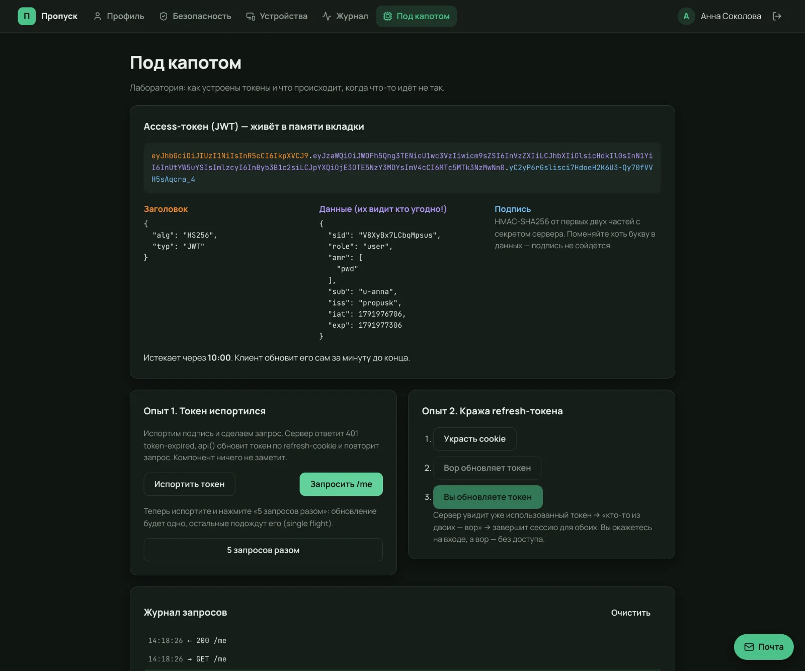
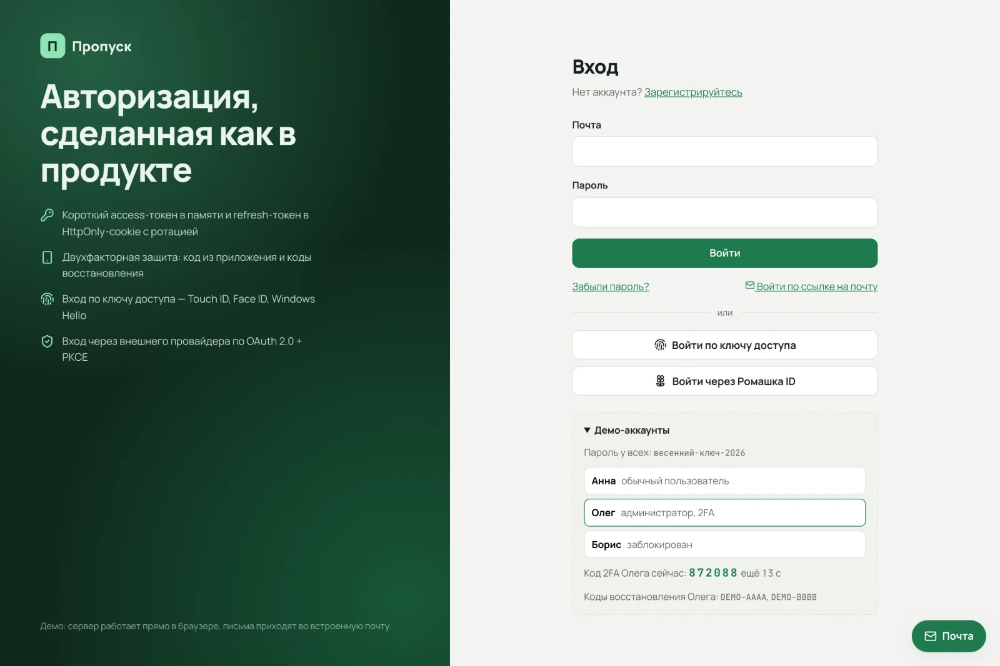
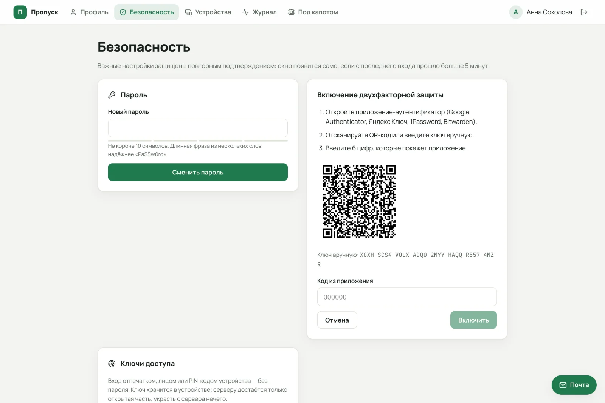
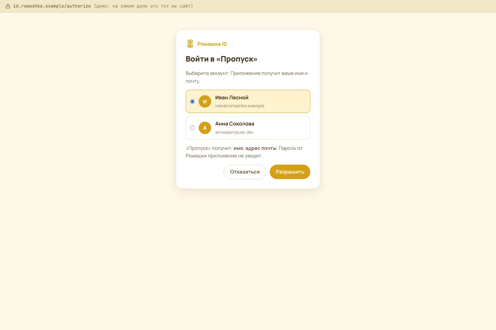
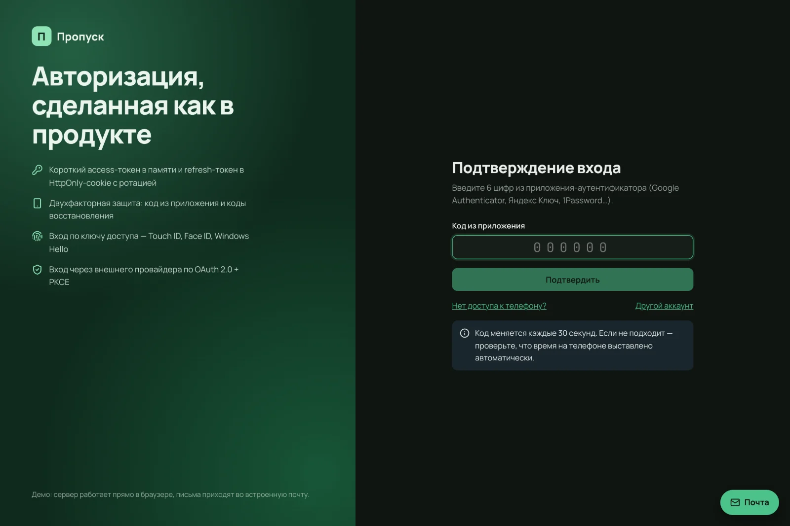

# Пропуск — авторизация, сделанная как в продукте

Регистрация с подтверждением почты, вход по паролю с защитой от перебора, **короткий JWT +
refresh-токен в HttpOnly-cookie с ротацией и обнаружением кражи**, двухфакторная защита
(TOTP), **ключи доступа (passkeys)**, вход через провайдера по **OAuth 2.0 + PKCE + OpenID
Connect**, ссылки из писем, устройства, режим судо, роли.

**Демо:** https://dmitriy9427.github.io/propusk/ · **Учебник:** [docs/](docs/README.md)

Сервер — Hono. Один и тот же код работает на Node (настоящие HttpOnly-cookie) и прямо в браузере
через MSW (демо на GitHub Pages). Письма приходят во встроенную «Почту».



| Вход | Двухфакторная защита: QR и код |
| --- | --- |
|  |  |

| «Ромашка ID» — провайдер OAuth | Второй шаг входа |
| --- | --- |
|  |  |

## Что внутри

**Пароли.** PBKDF2-SHA256 с солью (600 000 повторов), сравнение за постоянное время. Одна и та
же ошибка и одно и то же время ответа для «нет почты» и «неверный пароль». Блокировка после
пяти неудач с удвоением паузы. Правила пароля по NIST — общие для формы и сервера (zod).

**Токены.** Access — JWT на 10 минут, только в памяти вкладки. Refresh — 256 случайных бит в
cookie `HttpOnly; SameSite=Strict; Path=/api/auth`, в базе — его хеш. **Ротация** на каждом
обновлении: предъявили использованный токен — значит, его украли, и сессия отзывается для
всех. Сессия проверяется на каждом запросе: завершили устройство — его токен перестал работать
сразу. CSRF закрыт `SameSite` и обязательным заголовком.

**Клиент.** `api()` сам подставляет токен, при 401 обновляет его **один раз на все запросы**
(single flight) и **одной вкладкой на все вкладки** (Web Locks), при 403 `reauth-required`
показывает окно «Подтвердите, что это вы» и повторяет запрос. Выход в одной вкладке выходит во
всех (BroadcastChannel). Охрана страниц — middleware React Router 8, защита от открытого редиректа.

**Двухфакторная защита.** TOTP по RFC 6238 на Web Crypto (сверено с эталоном стандарта), QR без
сторонних сервисов, 10 одноразовых кодов восстановления, билет второго шага на 5 минут, один код
не принимается дважды.

**Passkeys.** WebAuthn с `@simplewebauthn`: регистрация и вход без почты (discoverable keys),
одноразовые вызовы, счётчик. В e2e — виртуальный аутентификатор Chrome.

**OAuth 2.0 + OIDC.** Демо-провайдер «Ромашка ID» со своими ключами ES256 и JWKS. `state`
(против подмены входа), PKCE (перехваченный код бесполезен), `nonce`, проверка `iss`/`aud`/подписи,
безопасная привязка аккаунтов по подтверждённой почте.

**Остальное.** Ссылки из писем — одноразовые, с коротким сроком, в базе хеши, токен убирается
из адреса. Режим судо для опасных действий. Роли с проверкой на сервере. Журнал событий.
Страница **«Под капотом»**: расшифровка JWT, «испортить токен», «украсть refresh-токен» — по шагам.

**62 теста:** 49 в Vitest (сервер с управляемыми часами и «банкой cookie», клиент с подменённым
fetch, эталонные векторы TOTP) и 13 сценариев Playwright, включая passkeys.

## Запуск

```bash
npm install
npm run dev                      # демо: сервер в браузере, http://localhost:5174

npm run server                   # настоящий сервер на Node (порт 8787)…
npm run dev:real                 # …и сайт к нему: cookie настоящие HttpOnly

npm run check                    # линтер, типы, тесты, сборка
npm run e2e                      # Playwright
```

Демо-аккаунты (пароль `весенний-ключ-2026`): `anna@propusk.dev`, `admin@propusk.dev` (2FA — код
показан на странице входа), `boris@propusk.dev` (заблокирован).

## Стек

Hono · jose · @simplewebauthn · Web Crypto · React 19 · React Router 8 (middleware) ·
TanStack Query · react-hook-form · zod 4 · MSW 3 · Vitest · Playwright · TypeScript 7 · Vite 8

## Учебник

[docs/](docs/README.md): пароли, токены, клиент, 2FA, passkeys, OAuth, ссылки из писем, режим судо и
роли, сервер в двух средах, тесты — каждая глава от «зачем» до кода по частям, с атаками и
заданиями. Плюс [найденные баги](docs/lessons.md) и [шпаргалка к собеседованию](docs/interview.md).

---

Автор — [Дмитрий Рябов](https://dmitriy9427.github.io/resume/). MIT.
