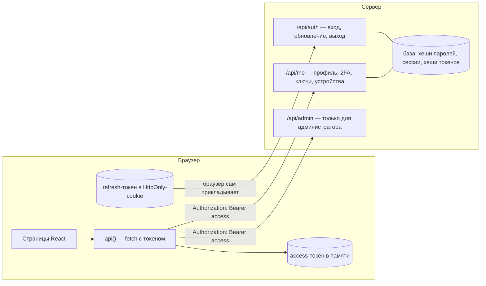

# 00. С чего начать

## Два слова, которые путают все

| | Вопрос | Пример |
| --- | --- | --- |
| **Аутентификация** (authentication) | **Кто** вы? | ввели пароль — сервер убедился, что вы Анна |
| **Авторизация** (authorization) | **Что** вам можно? | Анна — обычный пользователь, в «Пользователи» ей нельзя |

Сначала аутентификация, потом авторизация. В разговоре оба называют «авторизацией», но на
собеседовании разницу спросят.

## Словарь в одну строку

| Слово | Простыми словами |
| --- | --- |
| **Хеш** | «Отпечаток» данных: из пароля получить хеш легко, из хеша пароль — нельзя |
| **Соль** | Случайные байты, которые добавляют к паролю перед хешированием: одинаковые пароли дают разные хеши |
| **Сессия** | Запись на сервере «это устройство вошло как Анна» |
| **Токен** | Строка, которую клиент показывает серверу вместо пароля: «я уже входил» |
| **JWT** | Токен-«паспорт»: внутри данные (кто, до когда), снаружи подпись сервера |
| **Access-токен** | Короткоживущий (10 минут) токен для запросов к API |
| **Refresh-токен** | Долгоживущий (30 дней) токен, чтобы получить новый access, не вводя пароль |
| **Ротация** | Каждый раз, обновляя токены, выдаём **новый** refresh, а старый больше не принимаем |
| **Cookie** | Маленькие данные, которые браузер сам отправляет на сервер с каждым запросом |
| **HttpOnly** | Флаг cookie: JavaScript страницы её не прочитает |
| **SameSite** | Флаг cookie: не отправлять её в запросах с чужих сайтов |
| **XSS** | Атака: на ваш сайт попал чужой скрипт и выполняется у пользователя |
| **CSRF** | Атака: чужой сайт отправляет запрос на ваш, а браузер сам прикладывает cookie |
| **2FA, второй фактор** | Кроме пароля (что знаете) — ещё телефон (что у вас есть) |
| **TOTP** | Шесть цифр, которые меняются каждые 30 секунд (Google Authenticator) |
| **Passkey (ключ доступа)** | Вход отпечатком или лицом: устройство подписывает «вызов» своим закрытым ключом |
| **OAuth 2.0** | Протокол «войти через другой сервис» |
| **OpenID Connect (OIDC)** | Надстройка над OAuth: сервис выдаёт `id_token` — «это действительно Иван» |
| **PKCE** | Защита OAuth: перехваченный код без секретной пары бесполезен |
| **Перебор (brute force)** | Пробовать пароли один за другим, пока не подойдёт |
| **Режим судо (step-up)** | Перед опасным действием подтвердить личность ещё раз |
| **RBAC** | Права по ролям: пользователь, администратор |

## Картина целиком



Два токена — два разных пути:
- **access-токен** клиент сам кладёт в заголовок `Authorization` каждого запроса к API;
- **refresh-токен** лежит в cookie, браузер прикладывает её только к адресам `/api/auth/…`.

## Путь одного входа

Анна вводит почту и пароль и нажимает «Войти»:

```mermaid
sequenceDiagram
    actor Анна
    participant К as Клиент
    participant С as Сервер
    participant Б as База

    Анна->>К: почта + пароль
    К->>С: POST /api/auth/login
    С->>Б: найти пользователя по почте
    С->>С: PBKDF2(пароль, соль) == хеш из базы?
    С->>Б: создать сессию, сохранить ХЕШ refresh-токена
    С-->>К: { accessToken } + Set-Cookie: propusk_rt=…; HttpOnly
    К->>К: access-токен — в переменную (не в localStorage!)
    К->>С: GET /api/me, Authorization: Bearer …
    С->>С: подпись JWT верна? сессия не отозвана?
    С-->>К: { name: 'Анна Соколова', … }
```

Через 10 минут access-токен истечёт. Клиент заметит это сам, обменяет refresh-cookie на
новую пару токенов и повторит запрос. Анна ничего не увидит ([глава 04](04-client.md)).

## Как читать код

```
server/            сервер (один и тот же для Node и демо в браузере)
  core.ts          ядро: сессии, ротация токенов, проверки
  routes/          маршруты: auth, me, admin, oauth
  lib/             криптография, JWT, TOTP, passkeys, cookie
  provider/        демо-провайдер «Ромашка ID»
shared/schemas.ts  правила полей — общие для формы и сервера
src/auth/          клиент: токены, api(), вкладки, PKCE, passkeys
src/pages/         страницы
```

В начале каждого файла — комментарий «что и зачем». Начинайте с него.
