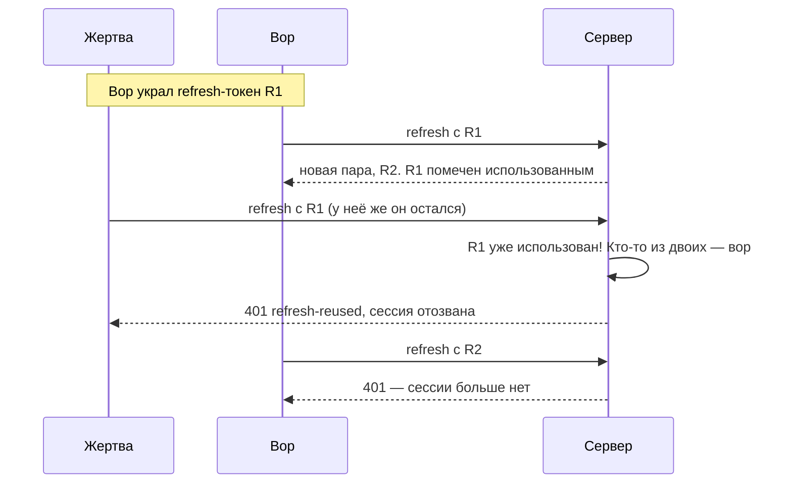

# 03. Токены и сессии

## Зачем токены

HTTP «без памяти»: каждый запрос — как новый человек у двери. Вводить пароль на каждый
запрос невозможно. Поэтому после входа сервер выдаёт **пропуск** — токен — и дальше клиент
показывает его вместо пароля.

## Два способа: сессия или JWT

**Сессия на сервере.** Токен — случайная строка, а на сервере запись «строка abc → Анна».
- ✓ отозвать мгновенно: удалили запись — токен перестал работать;
- ✗ каждый запрос — поход в базу.

**JWT (JSON Web Token).** Токен сам содержит «кто и до когда» и подписан сервером.
- ✓ проверить можно без базы: только подпись;
- ✗ **нельзя отозвать**: подписанный токен работает до конца срока.

### Как устроен JWT

Три части через точку: `заголовок.данные.подпись`.

```
eyJhbGciOiJIUzI1NiJ9 . eyJzdWIiOiJ1LWFubmEiLCJyb2xlIjoidXNlciIsImV4cCI6MTc5MTk3NjY3MX0 . OmAxrFmg…
```

```json
// заголовок                // данные (payload)                  // подпись
{ "alg": "HS256" }          { "sub": "u-anna",                   HMAC-SHA256(
                              "sid": "Pk36onfs…",                   заголовок + "." + данные,
                              "role": "user",                       секрет сервера)
                              "amr": ["pwd"],
                              "exp": 1791976671 }
```

**Данные не зашифрованы** — это просто base64. Вставьте любой JWT на jwt.io и прочитаете всё.
Защищает **подпись**: поменяете `"role": "user"` на `"admin"` — подпись не сойдётся, сервер
отклонит токен. Отсюда правило: в JWT не кладут секреты.

Посмотрите на свой токен: страница «Под капотом», раскрашены все три части.

## Решение «Пропуска»: короткий JWT + длинный refresh

| | Access-токен | Refresh-токен |
| --- | --- | --- |
| Что это | JWT | случайная строка 256 бит |
| Срок | 10 минут | 30 дней |
| Где на клиенте | в памяти (переменная) | в HttpOnly-cookie |
| Куда отправляется | заголовок `Authorization` в каждый запрос к API | только на `/api/auth/*` |
| Что в базе | ничего | **хеш** токена в записи сессии |
| Если украли | вор пользуется до 10 минут | ротация обнаружит кражу ([ниже](#ротация-и-обнаружение-кражи)) |

Получаем плюсы обоих способов: короткий JWT быстро проверяется, а долгоживущая часть — это
сессия в базе, её можно отозвать.

### Отзыв сразу, а не через 10 минут

Чистый JWT отозвать нельзя. Поэтому в «Пропуске» в токене есть `sid` — id сессии, и сервер
на каждом запросе проверяет, жива ли она ([server/core.ts](../server/core.ts) → `requireAuth`):

```ts
const claims = await verifyAccessToken(secret, token, now)       // ① подпись, срок, издатель
const session = sessions.find((s) => s.id === claims.sid)        // ② сессия есть?
if (!session || session.revokedAt) throw unauthorized('session-ended', 'Сессия завершена')
if (user.blocked) throw forbidden('blocked', …)                  // ③ не заблокирован?
```

Завершили сессию на другом устройстве — её access-токен перестаёт работать на **следующем
же** запросе. Цена — один поиск в базе на запрос. Для сервиса входа это разумно; в
высоконагруженном API сессии держат в Redis.

Проверка подписи ① — с явным списком алгоритмов:

```ts
await jwtVerify(token, key, { issuer: 'propusk', algorithms: ['HS256'] })
```

Классическая атака на JWT: в заголовке токена `"alg": "none"` (без подписи) — и плохая
библиотека «послушно» не проверяет подпись. Список `algorithms` говорит: «принимаем только
HS256, что бы ни было написано в токене».

## Где хранить токен в браузере

| Место | Прочитает ли чужой скрипт (XSS) | Отправится ли само на чужой запрос (CSRF) | Переживёт перезагрузку |
| --- | --- | --- | --- |
| `localStorage` | **да** — `localStorage.getItem(…)` | нет | да |
| переменная в памяти | очень сложно | нет | нет |
| обычная cookie | **да** — `document.cookie` | **да** | да |
| HttpOnly-cookie | **нет** | да, если не защитить | да |

Решение:
- **access-токен — в памяти.** XSS-скрипт не найдёт его в хранилищах; после перезагрузки
  токена нет — не беда, его выдадут заново по refresh;
- **refresh-токен — в HttpOnly-cookie.** JavaScript её не видит вообще. Отправку с чужих
  сайтов закрываем отдельно (ниже, CSRF).

> Честная оговорка: если на сайте XSS, злоумышленник может **делать запросы от имени
> пользователя**, пока тот на странице. Хранение токенов этого не отменяет — но не даёт
> **унести** токены и пользоваться ими потом, с другого компьютера.

## Флаги cookie — [server/lib/cookies.ts](../server/lib/cookies.ts)

```ts
const cookie = `${name}=${value}; Max-Age=${maxAgeSec}; Path=${path}; HttpOnly; SameSite=Strict${secure}`
```

| Флаг | Что делает | От какой атаки |
| --- | --- | --- |
| `HttpOnly` | JavaScript не может прочитать cookie | XSS не украдёт refresh-токен |
| `Secure` | только по HTTPS | перехват в открытом Wi-Fi |
| `SameSite=Strict` | не отправлять, если запрос начат с другого сайта | CSRF |
| `Path=/api/auth` | отправлять только на адреса входа | меньше мест, где токен «светится» |
| `Max-Age=2592000` | живёт 30 дней | — |

## Ротация и обнаружение кражи

Refresh-токен живёт 30 дней. Если его украдут, вор получит доступ на месяц. Защита — **ротация**:
каждый раз, обновляя токены, сервер выдаёт **новый** refresh, а старый помечает использованным.



Сервер не знает, кто из двоих вор, поэтому завершает сессию для **обоих**. Настоящий
пользователь просто войдёт снова, а вор потеряет доступ.

Код — [server/core.ts](../server/core.ts) → `rotateRefresh`:

```ts
const hash = await sha256(token)                                     // ① в базе только хеши

const reused = sessions.find((s) => s.usedHashes.includes(hash))     // ② этот токен уже меняли?
if (reused) {
  revokeSession(deps, reused, 'Повторно использован старый refresh-токен — возможна кража')
  audit(deps, reused.userId, 'refresh-reuse', …)
  throw unauthorized('refresh-reused', 'Сессия завершена из соображений безопасности')
}

const session = sessions.find((s) => s.tokenHash === hash)          // ③ действующий?
if (!session || session.revokedAt || session.expiresAt < now || user.blocked) throw …

const next = randomToken()                                           // ④ новый токен
session.usedHashes.push(session.tokenHash)                           //   старый — в «использованные»
session.tokenHash = await sha256(next)
writeRefreshCookie(c, next)
```

- ① В базе лежит **хеш** токена, как и с паролями: утечка базы не даёт входа.
- ② Порядок проверок важен: сначала «не повтор ли это», потом «действующий ли».

Проверьте сами: «Под капотом» → «Опыт 2. Кража refresh-токена». Тест:
[server/auth.test.ts](../server/auth.test.ts), «кража refresh-токена».

## CSRF: чужой сайт и наша cookie

Cookie браузер прикладывает **сам**. Значит, злой сайт может сделать так:

```html
<!-- на evil.example -->
<form action="https://propusk.example/api/auth/refresh" method="POST">…</form>
<script>document.forms[0].submit()</script>
```

Браузер отправит запрос **с нашей cookie**. Это и есть CSRF (подделка межсайтового запроса).
Защита в два слоя:

1. **`SameSite=Strict`** — браузер не приложит cookie к запросу, начатому с чужого сайта.
2. **Обязательный заголовок `X-Propusk: 1`** ([server/routes/auth.ts](../server/routes/auth.ts)):

```ts
app.post('/refresh', async (c) => {
  if (c.req.header('x-propusk') !== '1') throw new ApiError(403, 'csrf', 'Нет заголовка X-Propusk')
  return c.json(await rotateRefresh(c))
})
```

HTML-форма вообще не умеет добавлять заголовки. А `fetch` с чужого сайта со своим
заголовком сначала отправит «предварительный» запрос CORS, и браузер не пропустит основной,
пока наш сервер не разрешит. Наш сервер не разрешает.

## Попробуйте сами

1. Откройте «Под капотом» и скопируйте access-токен на jwt.io. Что внутри?
2. Почему refresh-токен — случайная строка, а не JWT?
3. В DevTools → Application → Cookies (в режиме `npm run dev:real`) найдите `propusk_rt`.
   Можно ли прочитать её в консоли через `document.cookie`?

<details>
<summary>Ответы</summary>

1. `sub` (id пользователя), `sid` (сессия), `role`, `amr` (как вошли: `pwd`, `otp`, `hwk`…),
   `iss`, `iat`, `exp`. Никаких секретов.
2. Его всё равно проверяют по базе (ротация, отзыв), поэтому данные внутри ни к чему. Случайная
   строка короче и ничего не раскрывает.
3. Нет: из-за `HttpOnly` её не видно в `document.cookie`, хотя в DevTools она есть.
</details>
