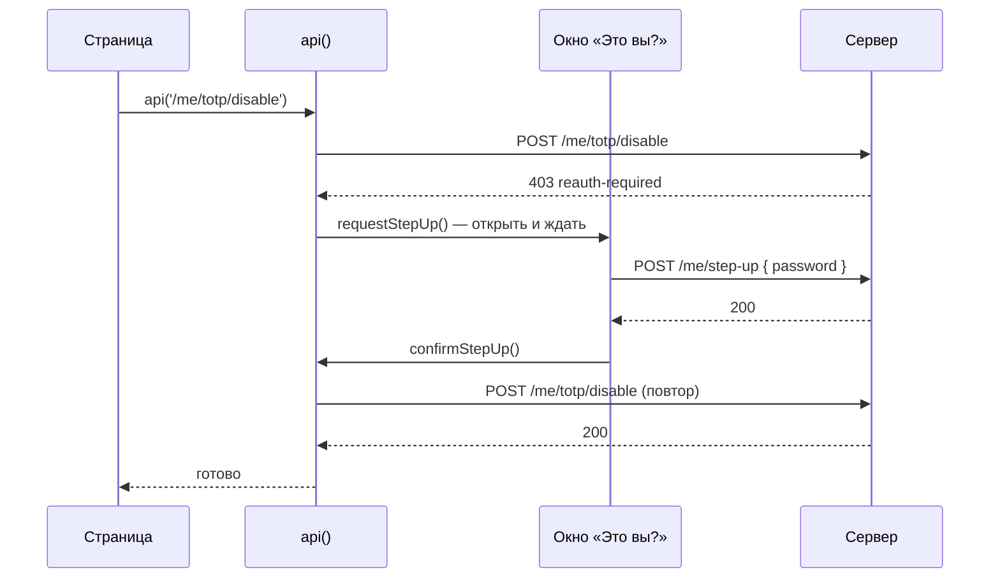

# 04. Клиент: токены без головной боли

Компоненты не должны знать про токены. Страница вызывает `api('/me')` и получает данные, а
всё остальное — подставить токен, обновить устаревший, попросить подтверждение личности —
происходит внутри. Файлы: [src/auth/](../src/auth/).

## Где хранится сессия — [session-store.ts](../src/auth/session-store.ts)

```ts
export type SessionState =
  | { status: 'loading' }                                       // ещё не знаем: идёт проверка
  | { status: 'anonymous'; reason?: string }                    // не вошёл (и, может быть, почему)
  | { status: 'authenticated'; user; accessToken; expiresAt }   // вошёл

let state: SessionState = { status: 'loading' }
const listeners = new Set<() => void>()

export function setSession(next: SessionState) {
  state = next
  listeners.forEach((listener) => listener())                  // сообщить всем подписчикам
}

export function useSession() {
  return useSyncExternalStore(subscribe, getSession)
}
```

Это **наблюдаемый объект** в двадцать строк: переменная, список подписчиков и функция
«изменить и сообщить». `useSyncExternalStore` — хук React для подписки на такие
хранилища: изменилась сессия — перерисовались компоненты, которые её читают. Ни Redux, ни
Context здесь не нужны.

Почему **три** состояния, а не `user | null`: при открытии страницы мы ещё не знаем,
вошёл ли человек (идёт запрос `refresh`). Если сразу считать его анонимом, он на мгновение
увидит форму входа, а потом его «перекинет» в кабинет.

## api() — fetch, который всё делает сам — [http.ts](../src/auth/http.ts)

```ts
export async function api<T>(path, { body, noRefresh, headers, ...init } = {}): Promise<T> {
  const send = () => fetch(`${API}${path}`, {
    ...init,
    credentials: 'same-origin',
    headers: { authorization: `Bearer ${getAccessToken()}`, … },   // ① токен в заголовок
    body: JSON.stringify(body),
  })

  let res = await send()

  if (res.status === 401 && !noRefresh) {                           // ② токен устарел
    const error = await toApiError(res.clone())
    if (error.code === 'token-expired' && (await refreshTokens())) res = await send()
  }

  if (res.status === 403) {                                         // ③ нужен «режим судо»
    const error = await toApiError(res.clone())
    if (error.code === 'reauth-required') {
      await requestStepUp()                                         //   показать окно и ждать
      res = await send()                                            //   повторить
    }
  }

  if (!res.ok) throw await toApiError(res)
  return await res.json()
}
```

Пошагово, что видит пользователь, когда access-токен истёк:

```
GET /api/me  → 401 token-expired         ← сервер: «пропуск просрочен»
POST /api/auth/refresh → 200             ← новый access + новый refresh
GET /api/me  → 200 { name: 'Анна' }      ← тот же запрос ещё раз
```

Компонент получил данные. Он даже не узнал, что было три запроса вместо одного.

`res.clone()` — тело ответа можно прочитать только один раз. Клон читаем, чтобы узнать код
ошибки, а оригинал остаётся для финального `toApiError(res)`.

## Одно обновление на всех — «single flight»

Страница открыла профиль, устройства и журнал — три запроса. Все три с устаревшим токеном,
все три получили 401. Наивный код сделает **три** `refresh`. Но refresh-токен меняется при
каждом обновлении (ротация)! Второй и третий запрос отправят уже использованный токен, и
сервер решит, что его украли ([глава 03](03-tokens.md#ротация-и-обнаружение-кражи)).

```ts
let refreshing: Promise<boolean> | null = null

export function refreshTokens(): Promise<boolean> {
  refreshing ??= withTabLock('propusk-refresh', async () => { …POST /auth/refresh… })
    .finally(() => { refreshing = null })
  return refreshing
}
```

`??=` — «присвоить, только если пусто». Первый вызов создаёт Promise, второй и третий
получают **тот же самый**. Все три ждут одного обновления. Это называют single flight —
«один рейс на всех». Тест: [http.test.ts](../src/auth/http.test.ts), «пять запросов… обновление ОДНО».

## Одно обновление на все вкладки — Web Locks — [tabs.ts](../src/auth/tabs.ts)

Внутри одной вкладки хватает общего Promise. Но у вас открыты **две вкладки**, и в обеих
токен истёк одновременно. Cookie общая, переменные — нет. Две вкладки отправят один и тот же
refresh-токен — и снова «кража».

```ts
export function withTabLock<T>(name: string, fn: () => Promise<T>): Promise<T> {
  return navigator.locks.request(name, fn)
}
```

`navigator.locks` (Web Locks API) — замок, общий для всех вкладок сайта. Как очередь к одной
кабинке: первая вкладка заходит, вторая ждёт снаружи. Когда первая обновилась, cookie уже
новая — и вторая идёт со свежим токеном.

## Выход во всех вкладках — BroadcastChannel

Вы нажали «Выйти» в одной вкладке. Во второй всё ещё видно личные данные, а её access-токен
(в памяти) работает до 10 минут. Нехорошо.

```ts
const channel = new BroadcastChannel('propusk-auth')        // «рация» на все вкладки сайта

export const broadcast = (message) => channel.postMessage(message)

// session.ts — при старте приложения:
onBroadcast((message) => {
  if (message.type === 'logout') setSession({ status: 'anonymous', reason: 'Вы вышли в другой вкладке' })
  if (message.type === 'login') void refreshTokens()         // вошли там — получим токен и здесь
})
```

Проверьте: «Под капотом» → «Открыть вторую вкладку», затем «Выйти» в одной из них.

## Старт приложения — восстановить сессию

После перезагрузки access-токена нет (он жил в памяти). Но есть refresh-cookie:

```ts
export function bootstrapSession() {
  started ??= (async () => {
    const ok = await refreshTokens()
    if (!ok) setSession({ status: 'anonymous' })
  })()
  return started
}
```

Получилось — человек «остался в системе», не получилось — показываем вход.

## Обновлять заранее

```ts
const delay = Math.max(5_000, session.expiresAt - Date.now() - 60_000)
timer = setTimeout(() => void refreshTokens(), delay)
```

За минуту до истечения обновляем токен сами. Запросы почти никогда не натыкаются на 401.
А если ноутбук спал и таймер опоздал, выручит повтор в `api()`.

## Охрана страниц — middleware роутера — [src/app/routes.tsx](../src/app/routes.tsx)

```ts
const requireUser: MiddlewareFunction = async ({ request }) => {
  await bootstrapSession()                                    // дождаться проверки сессии
  if (getSession().status !== 'authenticated') {
    const url = new URL(request.url)
    throw redirect(`/login?next=${encodeURIComponent(url.pathname + url.search)}`)
  }
}

{ path: '/', middleware: [requireUser], loader: noop, Component: AppLayout, children: [...] }
```

Middleware (React Router 8) выполняется **до** того, как страница начнёт загружаться.
Нет сессии — `redirect` на вход, а в `next` запоминаем, куда человек шёл.

> Middleware защищает **интерфейс**, а не данные. Данные защищает сервер: без токена
> `/api/me` ответит 401, сколько ни подделывай клиент.

### Куда вернуть после входа — [next.ts](../src/auth/next.ts)

```ts
export function safeNext(value) {
  if (!value?.startsWith('/') || value.startsWith('//') || value.startsWith('/\\')) return '/'
  return value
}
```

Если взять `next` как есть, злоумышленник пришлёт ссылку
`/login?next=https://evil.example/login`. Человек войдёт на настоящем сайте и тут же
окажется на поддельном, где его попросят «ещё раз ввести пароль». Это **открытый редирект**.
`//evil.example` — тоже чужой сайт («адрес без протокола»), поэтому его отдельно запрещаем.

## Подтверждение личности — окно, которое открывается само — [step-up.ts](../src/auth/step-up.ts)

```ts
export function requestStepUp(): Promise<void> {
  waiters ??= new Promise((resolve, reject) => {
    pending = { resolve, reject }        // запомнить, как завершить Promise
    emit()                               // окно подписано — оно откроется
  }).finally(() => { pending = null; waiters = null; emit() })
  return waiters
}
export const confirmStepUp = () => pending?.resolve()
export const cancelStepUp = () => pending?.reject(new Error('Подтверждение отменено'))
```

Это Promise, «ручки» которого (`resolve`, `reject`) вынесены наружу. `api()` ждёт его, окно
вызывает `confirmStepUp()`, когда человек ввёл пароль, — и `api()` повторяет запрос.



## Попробуйте сами

1. «Под капотом» → «Испортить токен» → «5 запросов разом». Сколько раз в журнале встречается `POST /auth/refresh`?
2. Почему `api()` не обновляет токен для `POST /auth/login` (`noRefresh: true`)?
3. Удалите `??=` в `refreshTokens` (замените на `=`) и запустите `npm test`. Какой тест упадёт?

<details>
<summary>Ответы</summary>

1. Один раз: остальные запросы ждали тот же Promise.
2. При входе токена ещё нет, и 401 там означает «неверный пароль», а не «токен устарел».
3. «пять запросов с устаревшим токеном → обновление ОДНО» — их станет пять.
</details>
