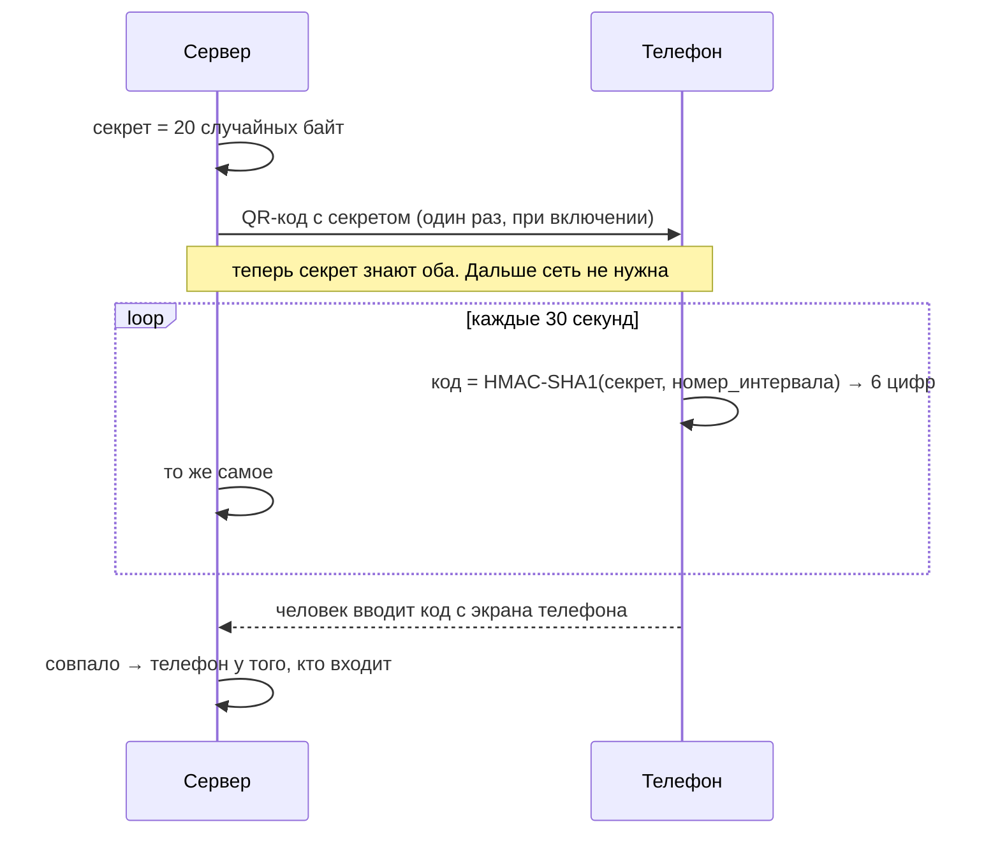
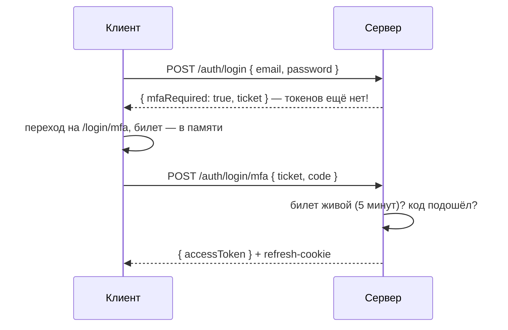

# 05. Двухфакторная защита

## Зачем

Пароли утекают: из чужих баз (люди используют один пароль везде), через фишинг, через
подглядывание. **Второй фактор** — то, что у вас **есть**: телефон. Украденный пароль без
телефона бесполезен.

| Фактор | Пример |
| --- | --- |
| что вы **знаете** | пароль |
| что у вас **есть** | телефон с приложением, USB-ключ |
| кто вы **есть** | отпечаток пальца, лицо |

## TOTP за пять минут

TOTP (Time-based One-Time Password) — шесть цифр, которые меняются каждые 30 секунд.
Google Authenticator, Яндекс Ключ, 1Password — все работают так.



**Номер интервала** = `floor(время_в_секундах / 30)`. В 12:00:00 и 12:00:29 номер один и тот
же, в 12:00:30 — следующий. Поэтому код меняется раз в 30 секунд.

### Как из HMAC получаются 6 цифр — [server/lib/totp.ts](../server/lib/totp.ts)

```ts
export async function hotp(secret: string, counter: number): Promise<string> {
  // ① HMAC-SHA1 от номера интервала (8 байт) с ключом-секретом → 20 байт
  const mac = new Uint8Array(await crypto.subtle.sign('HMAC', key, message))

  // ② «Динамическое усечение»: последние 4 бита говорят, откуда взять 4 байта
  const offset = mac[19] & 0x0f
  const number = ((mac[offset] & 0x7f) << 24) | (mac[offset + 1] << 16) | (mac[offset + 2] << 8) | mac[offset + 3]

  // ③ последние 6 цифр числа, с ведущими нулями
  return String(number % 1_000_000).padStart(6, '0')
}
```

Это алгоритм из стандартов RFC 4226 и 6238 — тот же, что в каждом приложении-аутентификаторе.
Тест сверяет его с эталонными значениями прямо из стандарта
([totp.test.ts](../server/lib/totp.test.ts)): для секрета `12345678901234567890` и
интервала 1 код должен быть `287082`.

### Часы расходятся

Время на телефоне может отставать на 10–20 секунд. Поэтому проверяем и соседние интервалы:

```ts
for (const counter of [current, current - 1, current + 1]) {
  if (counter <= lastUsedCounter) continue          // этот уже использовали — не принимаем
  if ((await hotp(secret, counter)) === code) return counter
}
```

### Один код — один раз

Код живёт 30–90 секунд. Если кто-то подсмотрит его через плечо, он может успеть ввести тот же
код. Поэтому сервер запоминает номер интервала последнего принятого кода (`lastCounter`) и
этот же код больше не принимает.

## Включение — три шага — [server/routes/me.ts](../server/routes/me.ts)

**1. Секрет и QR-код.**

```ts
app.post('/totp/setup', (c) => {
  requireRecentAuth(c)                                  // только в «режиме судо»
  user.pendingTotpSecret = generateTotpSecret()         // ещё НЕ включено
  return c.json({ secret, otpauthUrl: otpauthUrl(secret, user.email, 'Пропуск') })
})
```

`otpauthUrl` — ссылка вида
`otpauth://totp/Пропуск:anna@propusk.dev?secret=JBSW…&issuer=Пропуск&digits=6&period=30`.
QR-код — это просто эта ссылка, нарисованная квадратиками. Клиент рисует его сам
(библиотека `uqr`): если отдать секрет внешнему сервису «сделать QR», он его увидит.

**2. Проверить код.** Почему сразу не включить? Человек мог отсканировать неправильно, или
приложение не сохранило секрет. Если включить 2FA без проверки, он больше не войдёт.

```ts
app.post('/totp/enable', async (c) => {
  const counter = await verifyTotp(user.pendingTotpSecret, code, now)
  if (counter === null) throw … 'Код не подошёл — проверьте время на телефоне'
  user.totp = { secret: user.pendingTotpSecret, enabledAt: now, lastCounter: counter }
```

**3. Коды восстановления.**

```ts
  const codes = generateRecoveryCodes()                       // 10 штук вида 7KQ2-M9XA
  user.recoveryCodes = await Promise.all(codes.map(sha256))   // в базу — только хеши
  return c.json({ recoveryCodes: codes })                     // показываем один-единственный раз
```

Потеряли телефон — войти можно одним из кодов. Каждый одноразовый. В базе, как и у паролей,
только хеши. Показываем их один раз, поэтому на экране кнопки «Скопировать» и «Скачать .txt».

## Вход с 2FA — билет между шагами

Нельзя выдавать токены после пароля, если впереди код. Но и проверять пароль второй раз вместе
с кодом неудобно. Решение — **билет второго шага** (MFA ticket):



Свойства билета:
- случайный, в базе — его хеш;
- живёт **5 минут**;
- одноразовый: после успешного кода удаляется;
- на билет — не больше 5 попыток кода (иначе 1 000 000 вариантов перебрали бы за минуты).

Билет лежит на клиенте **в памяти**, а не в `sessionStorage`. Перезагрузили страницу на
вводе кода — начинайте с пароля. Это нарочно: так билет не утечёт.

## Коды восстановления при входе

```ts
const codeHash = await sha256(body.recoveryCode)
const index = user.recoveryCodes.indexOf(codeHash)
if (index < 0) throw … 'Такого кода нет или он уже использован'
user.recoveryCodes.splice(index, 1)                               // одноразовый
sendMail(deps, user.email, 'Использован код восстановления', …)   // сообщить владельцу
```

Письмо важно: если кодом воспользовался не владелец, тот хотя бы узнает об этом.

## Попробуйте сами

1. Войдите как Олег: пароль, затем код из демо-панели. Нажмите «Нет доступа к телефону?» и
   войдите кодом `DEMO-AAAA`. Получится ли войти тем же кодом второй раз?
2. Включите 2FA у Анны. Чем будете «сканировать» QR, если нет телефона?
3. Почему проверяем `[current, current − 1, current + 1]`, а не ±5 интервалов?

<details>
<summary>Ответы</summary>

1. Нет: «Такого кода нет или он уже использован». В почте Олега — письмо об использовании кода.
2. Введите ключ вручную в любое приложение-аутентификатор на компьютере (1Password,
   Bitwarden) — или, запустив проект локально (`npm run dev`), посчитайте код в консоли: `(await import('/server/lib/totp.ts')).totp('КЛЮЧ')`.
3. Чем шире окно, тем больше кодов подходит одновременно и тем проще угадать. ±30 секунд
   покрывают обычное расхождение часов.
</details>
