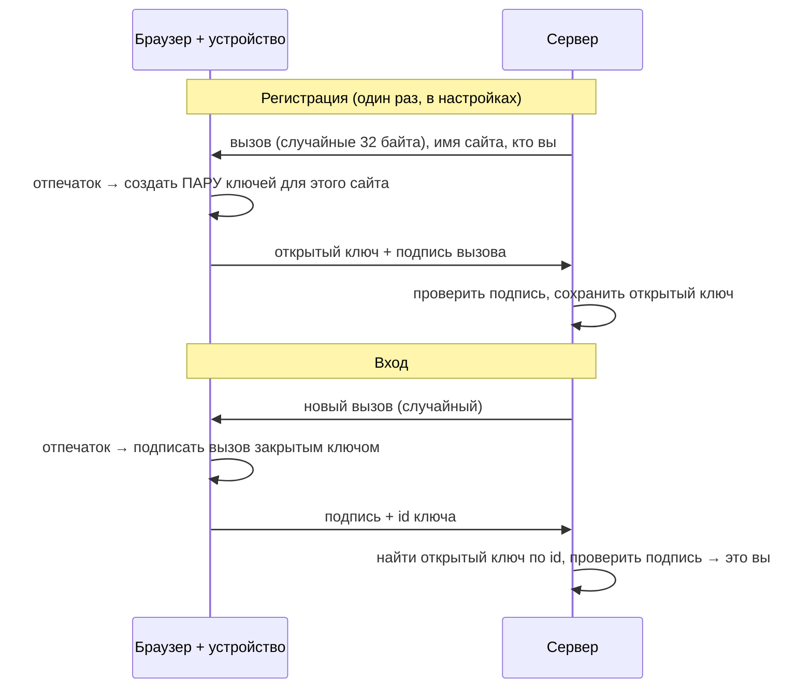

# 06. Ключи доступа (passkeys)

## Зачем, если есть пароль и 2FA

Пароль можно украсть с поддельного сайта (фишинг). Код 2FA — тоже: человек сам введёт его на
поддельной странице, а та за секунду перешлёт его на настоящий сайт. **Passkey украсть
нельзя**: браузер отдаст подпись только **настоящему** сайту, а с сервера красть нечего.

Для пользователя это просто: «Войти по ключу доступа» → приложить палец → готово.

## Идея: криптография с открытым ключом

У ключа две половинки:
- **закрытый ключ** — никогда не покидает устройство (защищённый чип телефона или ноутбука);
- **открытый ключ** — можно показывать всем, по нему проверяют подписи.

Подписать может только владелец закрытого ключа, а проверить подпись — кто угодно с открытым.



Почему с сервера **нечего красть**: в базе только открытые ключи, а с ними войти нельзя.
Почему **не работает фишинг**: ключ привязан к домену (**rpID**). На `propusk-login.evil` браузер
не предложит ключ, созданный для `propusk.example`.

Зачем **случайный вызов** (challenge) при каждом входе: иначе подпись можно было бы
перехватить и повторить. Новый вызов — новая подпись.

## Что делает сервер — [server/lib/passkeys.ts](../server/lib/passkeys.ts)

Разбор данных WebAuthn — бинарный формат CBOR, сертификаты, десятки проверок. Писать это
самим — верный путь к уязвимости, поэтому используем проверенную библиотеку
`@simplewebauthn/server`.

**Регистрация:**

```ts
const options = await generateRegistrationOptions({
  rpName: 'Пропуск',
  rpID: deps.rpID,                                    // домен: ключ будет работать только здесь
  userName: user.email,
  excludeCredentials: existing.map((p) => ({ id: p.id })),   // не регистрировать тот же ключ дважды
  authenticatorSelection: { residentKey: 'required', userVerification: 'preferred' },
})
return { options, challengeId: saveChallenge(deps, options.challenge, user.id) }
```

`residentKey: 'required'` — ключ «помнит» пользователя. Поэтому войти можно, **не вводя почту**:
браузер сам предложит сохранённые ключи этого сайта.

Вызов хранится на сервере под случайным `challengeId`, живёт 5 минут и **одноразовый**: после
проверки удаляется.

```ts
const result = await verifyRegistrationResponse({
  response,
  expectedChallenge: challenge.value,     // подписан НАШ вызов
  expectedOrigin: deps.origin,            // с НАШЕГО сайта
  expectedRPID: deps.rpID,
})
// сохранить открытый ключ, его id, счётчик использований
```

**Вход** устроен так же: `generateAuthenticationOptions` → браузер подписывает →
`verifyAuthenticationResponse` проверяет подпись открытым ключом из базы.

### Счётчик

```ts
passkey.counter = result.authenticationInfo.newCounter
```

Аппаратный ключ считает свои использования. Если пришёл счётчик **меньше** сохранённого,
значит, ключ скопировали (клонировали). Библиотека это проверяет. Ключи в iCloud и Google
Password Manager синхронизируются между устройствами, у них счётчик всегда 0 — это нормально.

## Что делает браузер — [src/auth/passkey.ts](../src/auth/passkey.ts)

```ts
export async function signInWithPasskey() {
  const { options, challengeId } = await api('/auth/passkey/options', { method: 'POST' })
  const response = await startAuthentication({ optionsJSON: options })   // ← окно «приложите палец»
  return api('/auth/passkey/verify', { method: 'POST', body: { challengeId, response } })
}
```

`startAuthentication` из `@simplewebauthn/browser` переводит JSON от сервера в формат
`navigator.credentials.get()` (встроенный в браузер WebAuthn API) и обратно.

Ошибки браузера переводим на человеческий язык:

| Ошибка | Когда | Что показываем |
| --- | --- | --- |
| `NotAllowedError` | нажали «Отмена» или прошло время | «Отменено или время вышло» |
| `InvalidStateError` | этот ключ уже добавлен | «Этот ключ уже добавлен» |
| `SecurityError` | сайт не на https и не localhost | «работают только на защищённом адресе» |

## Passkey — уже два фактора

Вход по ключу не просит код 2FA. Ключ — это и **что у вас есть** (устройство), и **кто вы**
(отпечаток или PIN устройства). Поэтому в токене `amr: ['hwk', 'user']` — «аппаратный ключ
и проверка пользователя».

## Как это проверяется без пальца

E2E-тест создаёт в Chrome **виртуальный аутентификатор** — программный «сканер отпечатков»
([e2e/auth.spec.ts](../e2e/auth.spec.ts)):

```ts
const cdp = await page.context().newCDPSession(page)
await cdp.send('WebAuthn.enable')
await cdp.send('WebAuthn.addVirtualAuthenticator', {
  options: { protocol: 'ctap2', transport: 'internal', hasResidentKey: true, hasUserVerification: true,
             isUserVerified: true, automaticPresenceSimulation: true },
})
```

Дальше тест нажимает «Добавить» в настройках и «Войти по ключу доступа» — и всё проходит
по-настоящему: настоящие ключи, настоящие подписи, настоящая проверка на сервере.

## Попробуйте сами

1. Добавьте ключ в «Безопасности» (на Mac — Touch ID, на Windows — Windows Hello), выйдите и
   войдите по ключу. Пришлось ли вводить почту?
2. Почему не нужно хранить закрытый ключ на сервере, чтобы проверить подпись?

<details>
<summary>Ответы</summary>

1. Нет: ключ «помнит» пользователя (`residentKey: 'required'`), браузер сам предложит его.
2. Подпись проверяют **открытым** ключом. Закрытый нужен только для создания подписи, и он
   остаётся в устройстве.
</details>
