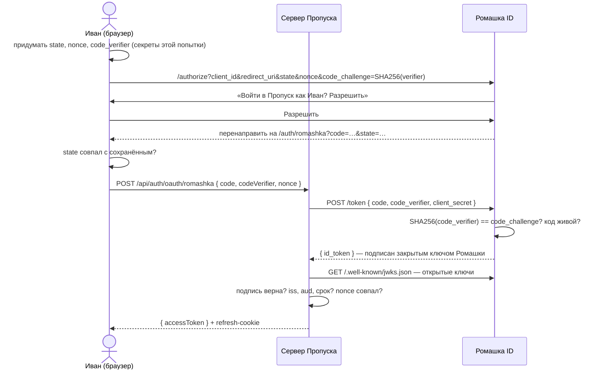

# 07. Вход через другой сервис (OAuth 2.0 + PKCE)

## Зачем

«Войти через …» — человеку не нужно придумывать ещё один пароль, а сайту — хранить его.
Сервис входа (**провайдер**) говорит сайту: «это Иван Лесной, его почта ivan@…, я проверил».

В «Пропуске» провайдер — демо-сервис **«Ромашка ID»**. В жизни он живёт на чужом домене;
здесь — рядом, под `/provider`, но протокол настоящий.

## Три участника и одна главная мысль

| Участник | Кто это |
| --- | --- |
| пользователь (браузер) | Иван |
| **клиент** | наш сервер Пропуска |
| **провайдер** | Ромашка ID |

Главная мысль: **пароль от Ромашки Пропуск не видит никогда**. Иван вводит его на сайте
Ромашки, а Пропуск получает только подтверждение.

## Весь путь



## Три секрета попытки — зачем каждый

Клиентская половина — [src/auth/romashka.ts](../src/auth/romashka.ts):

```ts
const state = random(16)
const nonce = random(16)
const verifier = random(32)
sessionStorage.setItem(KEY, JSON.stringify({ state, nonce, verifier, next }))
const params = new URLSearchParams({ client_id: 'propusk', redirect_uri, state, nonce,
  code_challenge: await s256(verifier), code_challenge_method: 'S256' })
```

### state — против подмены входа (CSRF)

Без `state` злоумышленник начинает вход **в своём** аккаунте Ромашки, получает ссылку
`/auth/romashka?code=ЕГО_КОД` и подсовывает её Ивану. Иван переходит — и оказывается в
Пропуске **под чужим аккаунтом**. Всё, что он туда сохранит, увидит злоумышленник.

С `state`: вернувшись, сверяем `state` из адреса с сохранённым в `sessionStorage`. Чужая ссылка
несёт чужой `state` — отклоняем.

```ts
if (!saved || saved.state !== search.get('state')) throw new Error('Попытка входа не совпала (state)…')
```

### PKCE — перехваченный код бесполезен

Код (`?code=…`) проходит через адресную строку: его можно увидеть в истории браузера, в логах
прокси, в расширениях. PKCE (Proof Key for Code Exchange) делает его бесполезным без пары:

- к провайдеру уходит **хеш**: `code_challenge = SHA256(code_verifier)`;
- при обмене кода на токены наш сервер отдаёт **сам** `code_verifier`;
- провайдер проверяет: `SHA256(verifier) == challenge`?

Перехватил код — без `verifier` его не обменять. А `verifier` из адреса никогда не проходил.

Провайдер ([server/provider/provider.ts](../server/provider/provider.ts)):

```ts
if ((await s256(get('code_verifier'))) !== record.codeChallenge) {
  throw new ApiError(400, 'invalid_grant', 'code_verifier не совпал с code_challenge')
}
```

### nonce — токен от этой попытки, а не от прошлой

`nonce` провайдер кладёт **внутрь** `id_token`. Наш сервер проверяет, что он совпадает с тем,
что прислал браузер. Перехваченный `id_token` от другой попытки входа не подойдёт.

## Обмен кода и проверка id_token — [server/routes/oauth.ts](../server/routes/oauth.ts)

```ts
// ① обмен кода — сервер к серверу, с секретом клиента, браузер не участвует
const tokenResponse = await provider.request('/token', {
  method: 'POST',
  body: new URLSearchParams({ grant_type: 'authorization_code', code, redirect_uri,
    client_id: 'propusk', client_secret: CLIENT_SECRET, code_verifier }),
})

// ② проверка id_token: подпись — открытым ключом провайдера (JWKS)
const jwks = await (await provider.request('/.well-known/jwks.json')).json()
const { payload } = await jwtVerify(idToken, createLocalJWKSet(jwks), {
  issuer: PROVIDER_ISSUER,   // выдал именно Ромашка ID
  audience: 'propusk',       // выдан именно НАМ (а не другому сайту)
  algorithms: ['ES256'],
})
// ③ nonce
if (payload.nonce !== body.nonce) throw … 'nonce не совпал'
```

`audience` важнее, чем кажется. Без проверки злоумышленник, у которого есть **свой** сайт со
входом через Ромашку, возьмёт `id_token`, выданный его сайту, и войдёт с ним к нам.

`id_token` подписан **ES256** — закрытым ключом провайдера. Открытые ключи провайдер
публикует по адресу `/.well-known/jwks.json` (JWKS — JSON Web Key Set). Так проверить токен
может кто угодно, не зная секретов провайдера.

## Кто это у нас?

```ts
let user = users.find((u) => u.identities.some((i) => i.provider === 'romashka' && i.subject === subject))
if (!user) {
  const byEmail = users.find((u) => u.email === email)
  if (byEmail && byEmail.emailVerified && payload.email_verified === true) {
    byEmail.identities.push({ provider: 'romashka', subject })   // привязать
  } else if (byEmail) {
    throw … 'Аккаунт с этой почтой уже есть — войдите паролем и привяжите Ромашку в настройках'
  } else {
    user = newFederatedUser(…)                                    // создать
  }
}
```

**Опасное место — автоматическая привязка по почте.** Если провайдер не проверяет почты,
злоумышленник заведёт у него аккаунт на **вашу** почту и войдёт в ваш Пропуск. Поэтому
привязываем, только если почта подтверждена **и у нас, и у провайдера** (`email_verified`).

Пользователя ищем по паре «провайдер + `sub`», а не по почте: почту в Ромашке можно сменить,
а `sub` (id в Ромашке) постоянный.

## Попробуйте сами

1. Войдите через Ромашку как «Анна Соколова». В чей аккаунт Пропуска вы попали и что появилось
   в профиле?
2. На странице Ромашки нажмите «Отказаться». Что ответит Пропуск?
3. Почему обмен кода делает сервер, а не браузер?

<details>
<summary>Ответы</summary>

1. В аккаунт Анны: почта совпала и подтверждена с обеих сторон, Ромашка привязалась
   («Вход через: Ромашка ID»). В журнале — «Привязан вход через Ромашка ID».
2. «Вы отказались входить через Ромашка ID»: провайдер вернул `error=access_denied` с тем же `state`.
3. Для обмена нужен `client_secret`. В браузере его спрятать нельзя — любой посмотрит код
   страницы. Сервер — «конфиденциальный клиент», ему можно доверить секрет.
</details>
