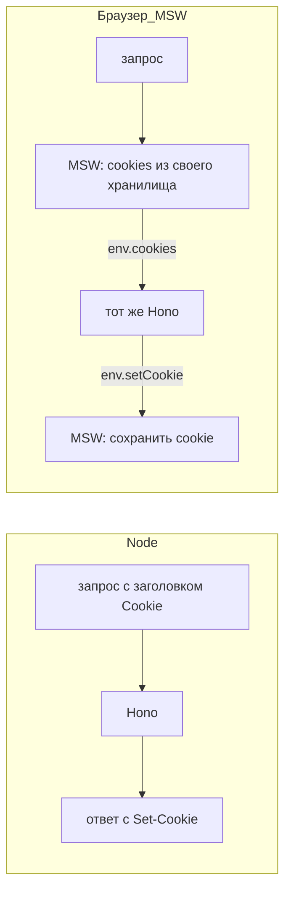

# 10. Сервер в двух средах

На GitHub Pages нет сервера: только файлы. А авторизации нужен сервер. Решение «Пропуска»:
**один и тот же** серверный код работает и на Node, и прямо в браузере.

## Hono — сервер на стандартах

[Hono](https://hono.dev) — маленький веб-фреймворк. Его приложение — это функция
`fetch(Request) → Response`, то есть стандартные объекты, которые есть и в Node, и в браузере.

```ts
const app = new Hono()
app.post('/api/auth/login', async (c) => c.json({ ok: true }))

// Node:     serve({ fetch: app.fetch, port: 8787 })
// браузер:  const response = await app.fetch(request)
// тест:     const response = await app.request('/api/auth/login', { method: 'POST' })
```

Вся криптография — на Web Crypto API (`crypto.subtle`, `crypto.getRandomValues`), он тоже есть
везде. Поэтому серверу не нужен Node-модуль `crypto`.

## Как сервер попадает в браузер — [src/mocks/browser.ts](../src/mocks/browser.ts)

MSW (Mock Service Worker) перехватывает `fetch` страницы:

```ts
const handler = async ({ request, cookies }) => {
  const env = { cookies, setCookie: [] }
  const response = await app.fetch(new Request(url, request), env)   // ← тот же Hono, что в Node
  const headers = new Headers(response.headers)
  for (const cookie of env.setCookie) headers.append('set-cookie', cookie)
  return new HttpResponse(response.body, { status: response.status, headers })
}
setupWorker(http.all('/api/*', handler), http.all('/provider/*', handler))
```

## Единственная разница — cookie

Браузер **запрещает** коду страницы задавать заголовки `Cookie` и `Set-Cookie` у запросов и
ответов, созданных из JavaScript. Иначе любой скрипт мог бы подделать или украсть cookie. Это
правильно, но мешает демо: Hono в браузере не может ни прочитать cookie из запроса, ни
поставить её в ответ.

MSW хранит cookie сам и передаёт их обработчику отдельным аргументом `cookies`. Поэтому
серверный код читает и пишет cookie через **мост** ([server/lib/cookies.ts](../server/lib/cookies.ts)):

```ts
export function readCookie(c, name) {
  const bridged = c.env?.cookies                // браузер: MSW положил cookie сюда
  return bridged ? bridged[name] : getCookie(c, name)   // Node: обычный заголовок Cookie
}

export function writeCookie(c, name, value, options) {
  const cookie = `${name}=${value}; …; HttpOnly; SameSite=Strict`
  c.header('Set-Cookie', cookie, { append: true })      // Node: обычный заголовок
  c.env?.setCookie?.push(cookie)                        // браузер: заберёт переходник
}
```



Маршруты моста не замечают: они вызывают `readCookie` и `writeCookie`.

**Честное ограничение демо:** MSW хранит cookie в `localStorage`, поэтому «HttpOnly» в демо
только изображается. Это видно в опыте «Кража refresh-токена» на странице «Под капотом». С
настоящим сервером (`npm run server` + `npm run dev:real`) cookie настоящие, и этот опыт
провести нельзя — что и доказывает смысл флага HttpOnly.

## Данные

Сервер хранит всё в одном объекте `Data` ([server/db.ts](../server/db.ts)). После каждого
изменения вызывается `db.changed()`:
- Node — пишет в `data/db.json`;
- браузер — в `localStorage` (`propusk:db:v1`).

Сбросить демо: в консоли `__propusk.reset()`.

## Настоящий сервер

```bash
npm run server      # API на http://localhost:8787, данные — data/db.json
npm run dev:real    # сайт; /api и /provider проксируются на 8787
```

Посмотрите в DevTools → Network ответ на вход: там настоящий
`Set-Cookie: propusk_rt=…; Path=/api/auth; HttpOnly; SameSite=Strict`.
